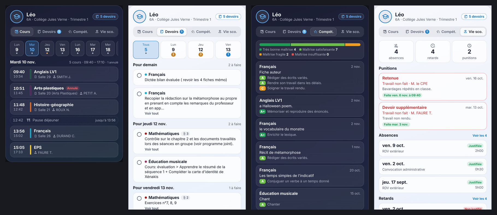

# Pronote Card (FR)

Carte Home Assistant **Pronote** : tout le suivi scolaire d'un enfant dans une seule carte à onglets — emploi du temps, devoirs, évaluations par compétences, notes, vie scolaire et cantine. Style verre, thème clair/sombre automatique, éditeur visuel, textes en français.

Elle utilise les capteurs de l'intégration [Pronote pour Home Assistant](https://github.com/delphiki/hass-pronote).



*Aperçu avec des données de démonstration.*

## Installation (HACS)
HACS → ⋮ → Dépôts personnalisés → URL de ce dépôt, catégorie **Tableau de bord** → installer → recharger la page.

## Configuration
```yaml
type: custom:pronote-card
entity: sensor.pronote_nom_prenom_class   # n'importe quel capteur Pronote de l'enfant
image: /local/image/enfant.jpg            # facultatif
```

La carte retrouve seule tous les capteurs de l'enfant à partir d'un seul (emploi du temps, devoirs, évaluations…).

| Option | Description |
|---|---|
| `entity` | Un capteur Pronote de l'enfant (ex. `…_class`) |
| `name` | Nom affiché (par défaut : prénom Pronote) |
| `image` | Photo ou avatar (ex. `/local/image/enfant.jpg`) |
| `default_tab` | `auto` (cours le matin, devoirs après 16 h), `edt`, `devoirs`, `evaluations`, `notes`, `vie`, `cantine` |
| `hide_empty_tabs` | Masque les onglets sans données (`true` par défaut) |
| `show_done_homework` | Affiche les devoirs déjà faits (`true` par défaut) |
| `homework_days` | Devoirs affichés sur N jours (14 par défaut) |
| `max_evaluations` | Nombre d'évaluations affichées (12 par défaut) |
| `theme` | `auto`, `light`, `dark` |

## Les onglets
- **Cours** : bande de jours pour choisir la date (tous les jours connus de Pronote, ~2 semaines). Couleur de chaque matière, salle, professeur, pause déjeuner, cours en cours mis en avant, cours terminés grisés, cours annulés barrés, contrôles signalés (point orange sur le jour).
- **Devoirs** : « Tous » ou un jour de remise précis, avec le nombre à faire par jour (pastille orange quand il y a un contrôle, une évaluation ou une dictée). « Voir tout » déplie le texte complet et les pièces jointes.
- **Compétences** : bilan de la période (très bonne maîtrise, satisfaisante, fragile, insuffisante) puis chaque évaluation avec ses compétences en pastilles colorées.
- **Notes** : moyenne générale, moyennes par matière et dernières notes (si l'établissement les publie).
- **Vie scolaire** : compteurs, punitions (faites / prévues), absences et retards (justifiés ou non).
- **Cantine** : menus de la semaine (si l'établissement les publie).

Pronote écrit les matières en majuscules sans accents : la carte les remet en forme (« Français », « Mathématiques », « Éducation musicale », « Histoire-géographie »…).

## Apparence : nuance de couleur

Dans l'éditeur visuel, à côté du thème :

| Option | Valeurs |
|---|---|
| `nuance` | `theme` (par défaut), `braise`, `ocean`, `lagon`, `foret`, `lavande`, `framboise`, `ambre`, `ardoise`, `perso` |
| `nuance_perso` | Couleur au choix (sélecteur de couleur), utilisée avec `nuance: perso` |
| `intensite` | De `0` (neutre) à `2` (très coloré), `1` par défaut |

**Une seule nuance pour toutes les cartes Johan854** : laisse `nuance: theme` et ajoute à ton thème Home Assistant :

```yaml
carte-nuance: "#2f8fd8"
```

## Historique des versions

- **1.0.0** : première version — emploi du temps avec choix du jour, devoirs par jour, compétences, notes, vie scolaire, cantine.

Licence MIT.
